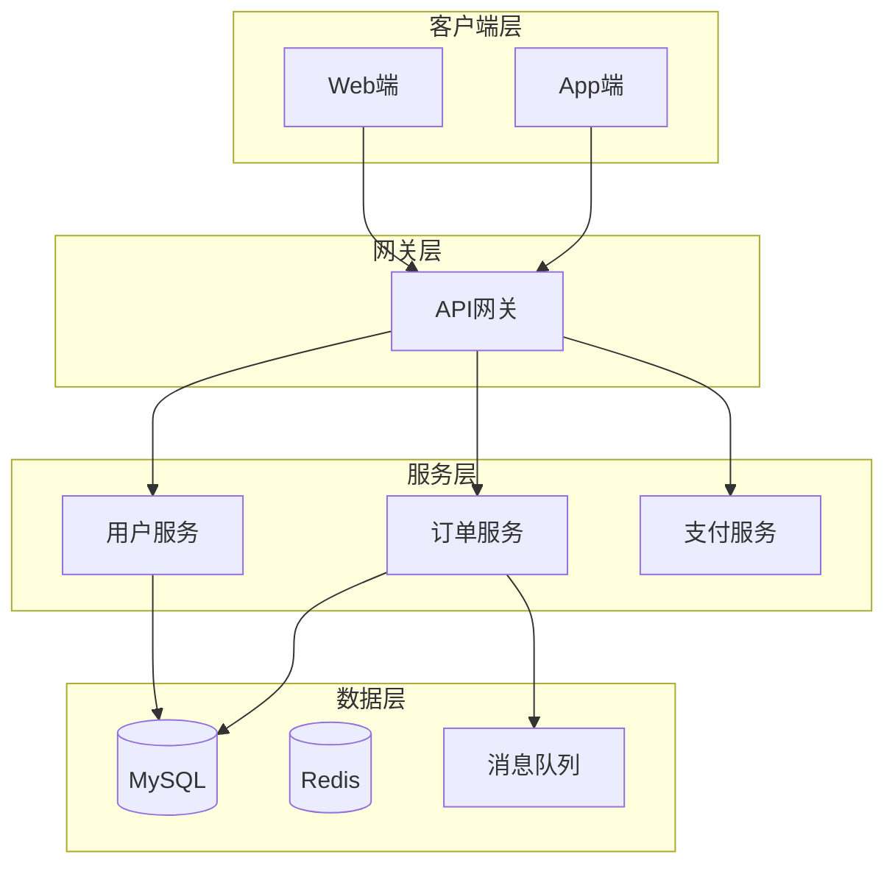
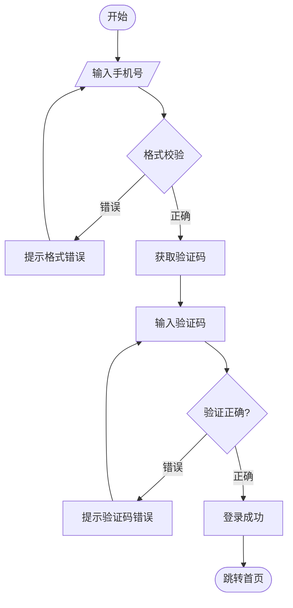
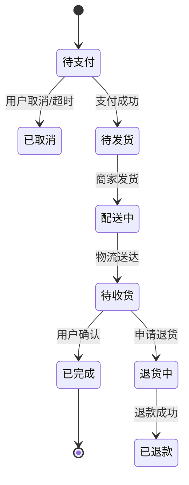
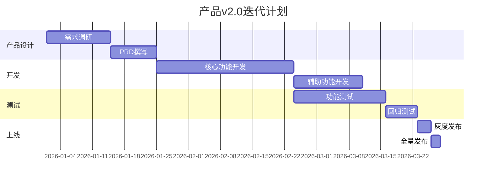
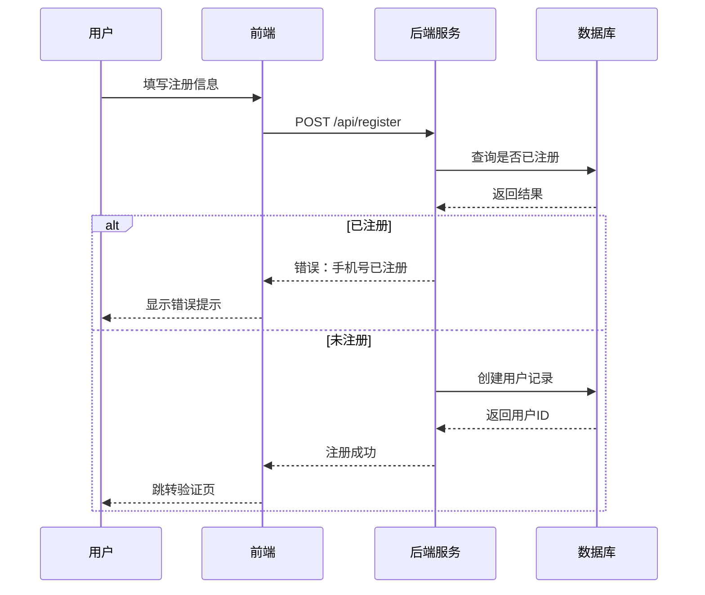
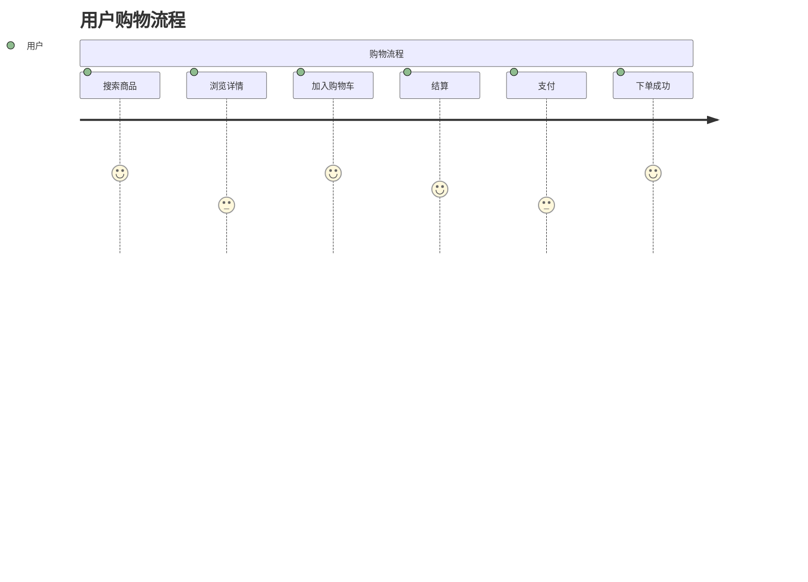
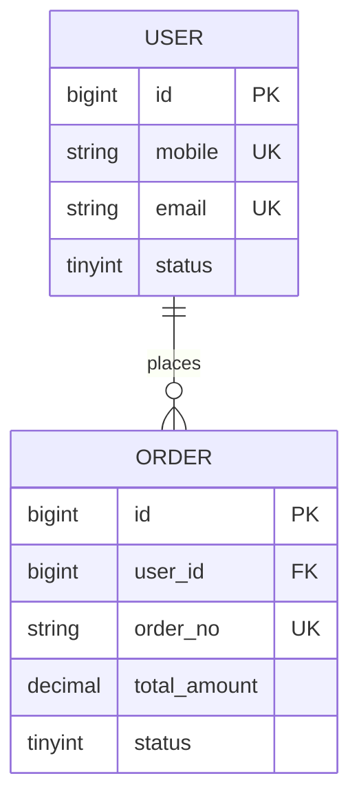
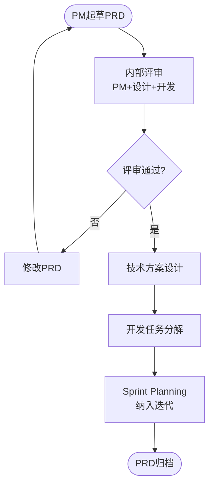

# Mermaid 图表速查

## 一、先选图，再画

| 要表达什么 | 用哪种图 | 关键要求 |
|-----------|---------|---------|
| 系统由哪些层/服务组成 | flowchart TB + subgraph | 分层不超过 4 层，每层只放本层职责 |
| 一条业务怎么走、哪里会失败 | flowchart TD | 判断节点用 `{}`，失败分支必须画出来 |
| 对象有哪些状态、怎么流转 | stateDiagram-v2 | 每个状态要有出口，终态标 `[*]` |
| 多方交互顺序、接口调用 | sequenceDiagram | 写明失败分支（alt/else），不画没有交互的参与者 |
| 用户体验的好坏起伏 | journey | 评分 1-5，只画 5-8 个关键步骤 |
| 数据结构与关系 | erDiagram | 标 PK/FK/UK，关系写清一对多方向 |
| 排期与依赖 | gantt | 有外部承诺才用；内部迭代用 Now/Next/Later |
| 评审/上线流程 | flowchart TD | 每个判断都要有「否」的回路 |

## 二、模板

产品架构图（分层）：

登录流程：

订单状态流转：

迭代甘特图：

注册时序图：

用户旅程图：

ER 图：

PRD 评审流程：

## 三、避坑

- 中文标签含空格、斜杠、括号时加双引号：`A["订单 / 支付"]`，否则部分渲染器解析失败。
- 同一行用 `&` 连接多个节点（`WEB & APP --> GW`），不要写两个箭头。
- 节点 ID 用英文短名，显示文本放引号里；ID 里不要出现中文和空格。
- `stateDiagram-v2` 中文状态名可直接用，但转移标签必须跟在冒号后。
- `gantt` 的 `after d1` 引用的是任务 ID，不是任务名；`dateFormat` 与日期写法要一致。
- `journey` 的评分是 1-5，冒号数量不能多也不能少。
- 图表最多 20 个节点；超过就拆成两张，别在一张图里讲完所有事。
- 图只是辅助：每张图下面补一句结论，别让读者自己解读。
